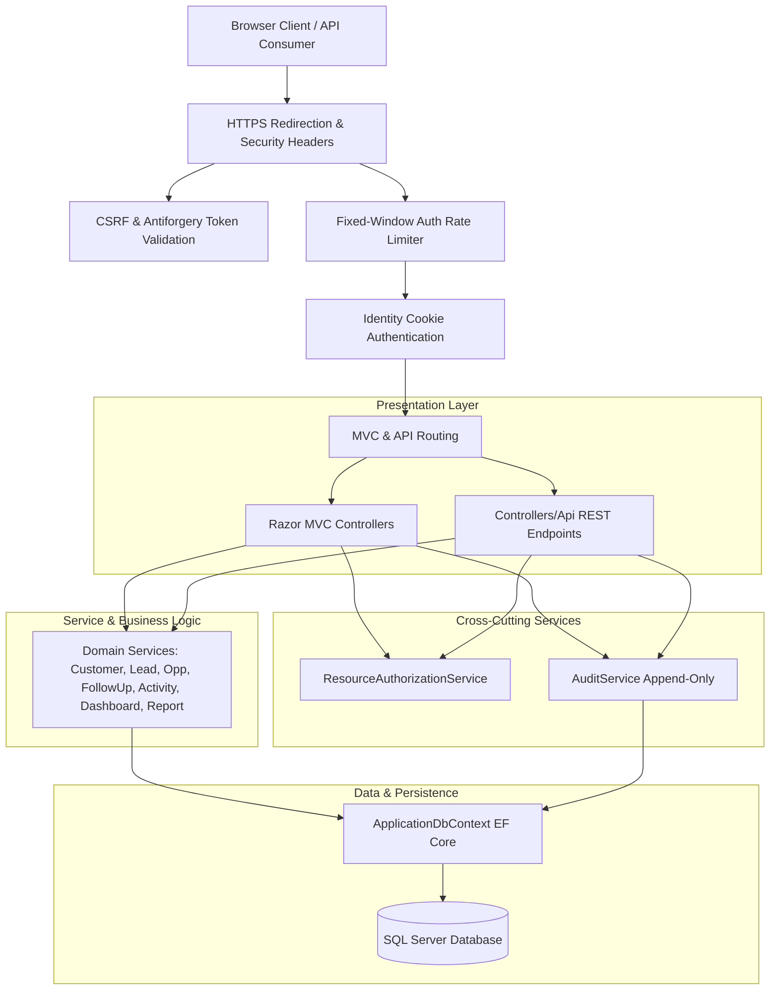

# AcxiomCRM - System Architecture & Design

AcxiomCRM is an enterprise-grade customer relationship management system engineered with ASP.NET Core 10, Entity Framework Core, SQL Server, and ASP.NET Core Identity.

---

## 1. Architectural Principles
1. **Separation of Concerns**: Clean isolation between Presentation (MVC/API), Application Services, Cross-Cutting Security/Audit, and Data Access.
2. **Never Expose Internal Entities**: Database entities (`Customer`, `Lead`, `Opportunity`, etc.) are never returned directly via API endpoints; all external payloads use dedicated DTOs in `DTOs/ApiDtos.cs`.
3. **Defense in Depth**: Client-side HTML5/unobtrusive validation paired with mandatory server-side validation via DataAnnotations, `IValidatableObject`, and service-layer business invariant checks.
4. **Append-Only Auditing**: Centralized `IAuditService` guarantees non-repudiation and complete history tracking without exposing mutation or deletion paths.
5. **Hierarchical Scope Security**: Enforces multi-tenant-style boundaries within an organization based on the reporting structure (`ManagerId`).

---

## 2. Authorization & Scoping Model

The system defines 3 primary roles:
- **Admin**: Unrestricted access across all CRM records, system configuration, audit logs, and user management.
- **Manager**: Access to records owned by themselves and any Sales Executives reporting to them (`u.ManagerId == currentManager.Id`). View-only access to user directories.
- **SalesExecutive**: Access strictly confined to records assigned to their own user ID (`OwnerId == currentUserId` or `AssignedTo == currentUserId`).

Centralized in `IResourceAuthorizationService`:
- `FilterCustomersAsync`
- `FilterLeadsAsync`
- `FilterOpportunitiesAsync`
- `FilterFollowUpsAsync`
- `FilterActivitiesAsync`
- `CanAccessCustomerAsync`
- `CanAccessLeadAsync`
- `CanAccessOpportunityAsync`
- `CanAccessFollowUpAsync`

---

## 3. Data Model Hierarchy & Relationships
- **ApplicationUser**: Inherits `IdentityUser`. Includes `FullName`, `IsActive`, `CreatedDate`, and self-referencing foreign key `ManagerId`.
- **Customer**: Root customer entity. Assigned to a Sales Executive (`OwnerId`).
- **Lead**: Lifecycle entity (`New` -> `Contacted` -> `Qualified` -> `Converted` / `Lost`). Converts into `Customer` and optional `Opportunity` in a single ACID transaction.
- **Opportunity**: Represents sales pipeline deals with stages (`Qualification`, `Proposal`, `Negotiation`, `Won`, `Lost`), `Amount`, `Probability`, and `ExpectedCloseDate`.
- **FollowUp**: Polymorphic activity scheduler linked to `CustomerId`, `LeadId`, and/or `OpportunityId`. Tracks `Planned`, `Completed`, `Missed`, and `Cancelled` states with automatic overdue detection.
- **Activity**: Historical interaction log (`Call`, `Meeting`, `Email`, `Task`) linked to customers and leads.
- **AuditLog**: Immutable compliance log containing `UserId`, `Action`, `Module`, `EntityName`, `RecordId`, sanitized `OldValue`, sanitized `NewValue`, `Result`, `CreatedDate`, and `IpAddress`.

---

## 4. UI & Presentation Framework
- **Framework**: Razor Pages / MVC with Bootstrap 5 CDN and Chart.js CDN.
- **No Node/Tailwind Build Step**: Clean, standard CSS and unobtrusive JavaScript libraries loaded directly without build pipeline friction.
- **Responsive Layout**: Reusable shared partials (`_Layout.cshtml`, `_Alerts.cshtml`, `_ValidationSummary.cshtml`, `_Pager.cshtml`, `_SearchBar.cshtml`, `_DeleteConfirmModal.cshtml`).
